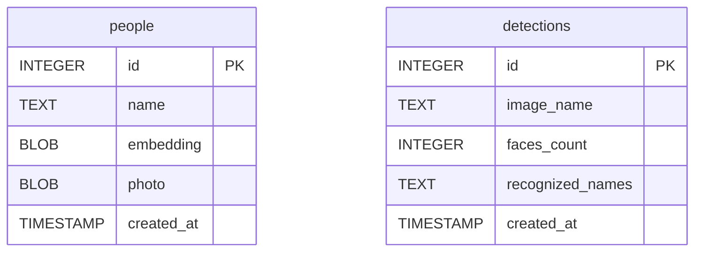
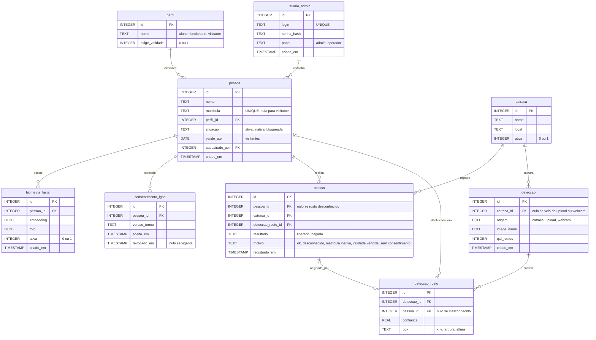

# Estrutura do Banco de Dados — Catraca de Reconhecimento Facial UBM

Versão: 1.0 · Data: 25/11/2026 · Repositório: https://github.com/Matheus-OV/Catraca-de-Reconhecimento-Facial-UBM

Este documento descreve o banco de dados em duas partes: o que **existe hoje no código** (seção 2) e o modelo **proposto** para a catraca do campus (seção 4). A seção 3 explica por que o modelo atual não basta. Nada da seção 4 está implementado ainda.

## 1. Visão geral

- Banco: SQLite (`sqlite3` nativo do Python), em um único arquivo.
- Arquivo: `reconhecimento.db` na pasta do projeto. Pode ser trocado pela variável `RF_DB_PATH`. Na Vercel fica em `/tmp/reconhecimento.db` e é apagado a cada reinício.
- Criação: as tabelas são criadas automaticamente por `init_db()` em `db.py`, chamada na partida da aplicação e antes de cada operação.
- Os arquivos de foto (recortes de rosto) também são gravados na pasta `photos/`, além da coluna `photo` do banco.

## 2. Modelo atual (implementado)

### 2.1 DER atual



As duas tabelas **não têm relacionamento** entre si. O vínculo entre uma detecção e as pessoas reconhecidas é feito só por texto (`recognized_names`).

### 2.2 Tabela `people` (pessoas cadastradas)

| Coluna | Tipo | Restrições | Descrição |
|---|---|---|---|
| `id` | INTEGER | PK, AUTOINCREMENT | Identificador da pessoa |
| `name` | TEXT | NOT NULL | Nome informado no cadastro (sem espaços nas pontas) |
| `embedding` | BLOB | NOT NULL | Vetor facial de 128 números `float64` (1024 bytes) |
| `photo` | BLOB | — | Recorte JPEG do rosto usado no cadastro |
| `created_at` | TIMESTAMP | DEFAULT CURRENT_TIMESTAMP | Data e hora do cadastro (UTC) |

### 2.3 Tabela `detections` (histórico de detecções)

| Coluna | Tipo | Restrições | Descrição |
|---|---|---|---|
| `id` | INTEGER | PK, AUTOINCREMENT | Identificador do evento |
| `image_name` | TEXT | — | Nome do arquivo analisado (ex.: `img.jpg`, `webcam_frame.jpg`) |
| `faces_count` | INTEGER | NOT NULL | Quantidade de rostos detectados |
| `recognized_names` | TEXT | — | Nomes reconhecidos separados por vírgula, ou `Nenhum` |
| `created_at` | TIMESTAMP | DEFAULT CURRENT_TIMESTAMP | Data e hora da detecção (UTC) |

### 2.4 Operações disponíveis (`db.py`)

| Função | O que faz |
|---|---|
| `init_db()` | Cria as tabelas se não existirem |
| `add_person(name, embedding_bytes, photo_bytes)` | Insere uma pessoa e devolve o `id` |
| `get_all_people()` | Lista as pessoas por nome, com a foto em Base64 |
| `delete_person(person_id)` | Remove a pessoa; devolve `True` se removeu |
| `save_detection(image_name, faces_count, recognized_names)` | Grava uma detecção no histórico |
| `list_detections(limit)` | Lista as detecções mais recentes |

## 3. Limitações do modelo atual

| Problema | Consequência |
|---|---|
| Sem relacionamento: `detections.recognized_names` é texto separado por vírgula, não referência a `people.id` | Se uma pessoa for excluída ou mudar de nome, o histórico perde a ligação. Também não dá para consultar "todas as detecções da pessoa X" com SQL |
| Não existe matrícula nem situação (ativa/inativa) | Não é possível aplicar a regra "só libera com matrícula ativa" |
| Não existe perfil (aluno, funcionário, visitante com validade) | Todos são tratados igual, sem prazo de acesso |
| Não existe registro de acesso liberado ou negado, nem catraca | O histórico é de análise de imagens, não de passagens |
| Não existe consentimento LGPD | O sistema guarda dado biométrico (rosto) sem registrar o aceite nem permitir a revogação |
| Não existem usuários administradores | As rotas de cadastro e exclusão não exigem login |
| Uma pessoa tem só uma foto/vetor | Não dá para cadastrar vários ângulos nem substituir um cadastro ruim sem apagar a pessoa |

## 4. Modelo proposto para a catraca (não implementado)

### 4.1 DER proposto



### 4.2 Descrição das tabelas

| Tabela | Papel | Chaves e relacionamentos |
|---|---|---|
| `perfil` | Tipos de pessoa (aluno, funcionário, visitante) e se exigem data de validade | 1 perfil → N pessoas |
| `pessoa` | Quem pode ser identificado: nome, matrícula, situação e validade | FK `perfil_id`; FK `cadastrado_por` → `usuario_admin` |
| `biometria_facial` | Vetor e foto do rosto. Separada de `pessoa` para permitir várias fotos e a exclusão do dado biométrico sem apagar a pessoa | FK `pessoa_id` |
| `consentimento_lgpd` | Registro do aceite e da revogação do uso do rosto | FK `pessoa_id` |
| `catraca` | Equipamentos físicos (ou telas) que enviam imagens | 1 catraca → N detecções e N acessos |
| `deteccao` | Cada imagem analisada. Substitui `detections` | FK `catraca_id` (opcional) |
| `deteccao_rosto` | Um registro por rosto da imagem, com a pessoa identificada e a confiança. Substitui o texto `recognized_names` | FK `deteccao_id`; FK `pessoa_id` (nula se "Desconhecido") |
| `acesso` | Decisão da catraca: liberado ou negado, com o motivo | FKs `pessoa_id`, `catraca_id`, `deteccao_rosto_id` |
| `usuario_admin` | Quem pode cadastrar e excluir pessoas e ver relatórios | Senha guardada como hash, nunca em texto |

### 4.3 Regras que o modelo permite aplicar

1. Só libera o acesso se a pessoa for reconhecida, tiver `situacao = 'ativa'`, tiver consentimento vigente (`revogado_em` nulo) e, para visitante, `valido_ate` não vencido.
2. Todo rosto que passa pela catraca gera um registro em `acesso`, liberado ou negado, com o motivo.
3. Excluir a biometria de uma pessoa (pedido LGPD) apaga só `biometria_facial`; o histórico de acessos continua ligado à pessoa pelo `id`.
4. Se a pessoa for removida, os registros de `acesso` e `deteccao_rosto` deixam de apontar para ela (`ON DELETE SET NULL`) em vez de perder o vínculo em silêncio.

### 4.4 Comando SQL (SQLite) do modelo proposto

```sql
PRAGMA foreign_keys = ON;

CREATE TABLE perfil (
    id              INTEGER PRIMARY KEY AUTOINCREMENT,
    nome            TEXT NOT NULL UNIQUE,
    exige_validade  INTEGER NOT NULL DEFAULT 0 CHECK (exige_validade IN (0, 1))
);

CREATE TABLE usuario_admin (
    id          INTEGER PRIMARY KEY AUTOINCREMENT,
    login       TEXT NOT NULL UNIQUE,
    senha_hash  TEXT NOT NULL,
    papel       TEXT NOT NULL CHECK (papel IN ('admin', 'operador')),
    criado_em   TIMESTAMP DEFAULT CURRENT_TIMESTAMP
);

CREATE TABLE pessoa (
    id              INTEGER PRIMARY KEY AUTOINCREMENT,
    nome            TEXT NOT NULL,
    matricula       TEXT UNIQUE,
    perfil_id       INTEGER NOT NULL REFERENCES perfil(id),
    situacao        TEXT NOT NULL DEFAULT 'ativa'
                    CHECK (situacao IN ('ativa', 'inativa', 'bloqueada')),
    valido_ate      DATE,
    cadastrado_por  INTEGER REFERENCES usuario_admin(id) ON DELETE SET NULL,
    criado_em       TIMESTAMP DEFAULT CURRENT_TIMESTAMP
);

CREATE TABLE biometria_facial (
    id          INTEGER PRIMARY KEY AUTOINCREMENT,
    pessoa_id   INTEGER NOT NULL REFERENCES pessoa(id) ON DELETE CASCADE,
    embedding   BLOB NOT NULL,
    foto        BLOB,
    ativa       INTEGER NOT NULL DEFAULT 1 CHECK (ativa IN (0, 1)),
    criado_em   TIMESTAMP DEFAULT CURRENT_TIMESTAMP
);

CREATE TABLE consentimento_lgpd (
    id            INTEGER PRIMARY KEY AUTOINCREMENT,
    pessoa_id     INTEGER NOT NULL REFERENCES pessoa(id) ON DELETE CASCADE,
    versao_termo  TEXT NOT NULL,
    aceito_em     TIMESTAMP NOT NULL DEFAULT CURRENT_TIMESTAMP,
    revogado_em   TIMESTAMP
);

CREATE TABLE catraca (
    id     INTEGER PRIMARY KEY AUTOINCREMENT,
    nome   TEXT NOT NULL,
    local  TEXT,
    ativa  INTEGER NOT NULL DEFAULT 1 CHECK (ativa IN (0, 1))
);

CREATE TABLE deteccao (
    id          INTEGER PRIMARY KEY AUTOINCREMENT,
    catraca_id  INTEGER REFERENCES catraca(id) ON DELETE SET NULL,
    origem      TEXT NOT NULL CHECK (origem IN ('catraca', 'upload', 'webcam')),
    image_name  TEXT,
    qtd_rostos  INTEGER NOT NULL,
    criado_em   TIMESTAMP DEFAULT CURRENT_TIMESTAMP
);

CREATE TABLE deteccao_rosto (
    id           INTEGER PRIMARY KEY AUTOINCREMENT,
    deteccao_id  INTEGER NOT NULL REFERENCES deteccao(id) ON DELETE CASCADE,
    pessoa_id    INTEGER REFERENCES pessoa(id) ON DELETE SET NULL,
    confianca    REAL NOT NULL DEFAULT 0,
    box          TEXT
);

CREATE TABLE acesso (
    id                 INTEGER PRIMARY KEY AUTOINCREMENT,
    pessoa_id          INTEGER REFERENCES pessoa(id) ON DELETE SET NULL,
    catraca_id         INTEGER NOT NULL REFERENCES catraca(id),
    deteccao_rosto_id  INTEGER REFERENCES deteccao_rosto(id) ON DELETE SET NULL,
    resultado          TEXT NOT NULL CHECK (resultado IN ('liberado', 'negado')),
    motivo             TEXT NOT NULL,
    registrado_em      TIMESTAMP DEFAULT CURRENT_TIMESTAMP
);

CREATE INDEX idx_pessoa_matricula   ON pessoa(matricula);
CREATE INDEX idx_biometria_pessoa   ON biometria_facial(pessoa_id);
CREATE INDEX idx_acesso_registrado  ON acesso(registrado_em);
CREATE INDEX idx_rosto_pessoa       ON deteccao_rosto(pessoa_id);
```

### 4.5 Como o modelo atual vira o proposto

| Hoje | Depois |
|---|---|
| `people.name` | `pessoa.nome` |
| `people.embedding`, `people.photo` | `biometria_facial.embedding`, `biometria_facial.foto` |
| `people.created_at` | `pessoa.criado_em` |
| `detections` (uma linha por imagem) | `deteccao` (uma linha por imagem) |
| `detections.recognized_names` (texto) | `deteccao_rosto.pessoa_id` (uma linha por rosto) |
| — | `perfil`, `consentimento_lgpd`, `catraca`, `acesso`, `usuario_admin` (novas) |

Para os cadastros que já existem, a migração deve criar a pessoa com perfil padrão e `situacao = 'ativa'`, sem matrícula, e exigir que o consentimento seja registrado antes de a pessoa ser liberada.

## 5. Observações

- O SQLite só aplica chaves estrangeiras com `PRAGMA foreign_keys = ON`, que precisa ser executado a cada nova conexão (em `get_conn()`).
- O banco guarda dado biométrico. O arquivo `.db` e a pasta `photos/` devem ficar fora do Git e ter acesso restrito.
